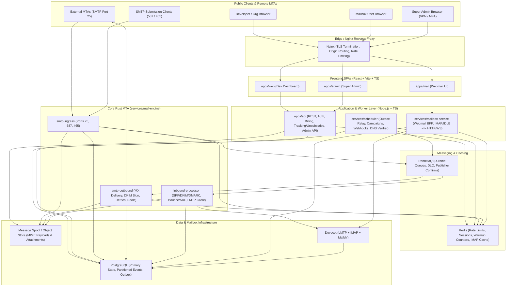
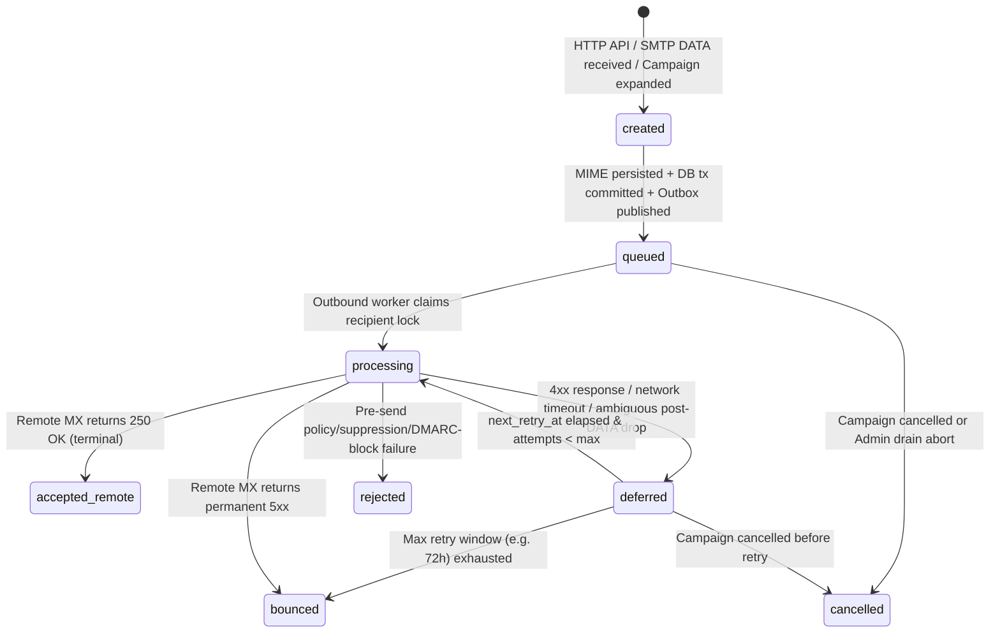

# Architecture & System Design

**Status:** Draft — Awaiting Stakeholder Approval  
**Target Capacity:** ~20M emails/month initial (~667k/day avg; 500–2,000+ msg/sec burst capacity), horizontally scalable beyond.

---

## 1. Requirements Analysis & Core Architectural Invariants

The platform unifies three distinct product surfaces onto one shared infrastructure core:

1. **Email Infrastructure SaaS (`apps/web`)**: Transactional REST API, SMTP relay credentials, bulk campaigns, templates, webhooks, analytics, deliverability diagnostics, billing.
2. **Custom Email Hosting & Webmail (`apps/mail`)**: Multi-domain virtual mailboxes, aliases, forwarding, catch-all, quotas, Gmail-class webmail client backed by Dovecot IMAP/LMTP.
3. **Platform Super Admin (`apps/admin`)**: Isolated operator control plane for tenant governance, MTA node draining, queue inspection/replay, IP pool & reputation management, MFA/RBAC, and versioned system configuration.

### Non-Negotiable System Invariants
- **No external delivery providers** (SES, SendGrid, Mailgun) and **no Postfix**.
- **Custom Rust MTA** handles all SMTP ingress (25, 587, 465), outbound MX delivery, MIME parsing/signing, SPF/DKIM/DMARC evaluation, and Dovecot LMTP handoff.
- **No Open Relay**: Unauthenticated port 25 only accepts recipients for verified hosted domains or platform bounce/FBL domains, rejecting unknown recipients during `RCPT TO` (preventing backscatter).
- **Durability Before Acknowledgment**: Never return `250 OK` on SMTP or `202 Accepted` on HTTP API, and never `ACK` a RabbitMQ delivery, until message metadata/state is committed in PostgreSQL and the MIME payload is durably persisted.
- **Single-Source Billing Isolation**: Billing/quota checks gate *acceptance* at ingress, never silently dropping already-queued messages during plan transitions.

---

## 2. Technology Stack Validation & Compatibility Findings

| Layer | Locked Stack | Validation & Compatibility Findings |
|---|---|---|
| **Frontend** | React, Vite, TypeScript, Tailwind CSS v4, shadcn/ui, Base UI, Lucide, TanStack Query, React Router, React Hook Form, Zod, Sonner | **Friction:** Classic `shadcn/ui` uses Radix UI primitives, whereas `Base UI` (`@base-ui/react`) is also specified. Mixing Radix and Base UI creates conflicting portal/focus-management behavior. **Resolution:** Standardize `shadcn/ui` strictly on Base UI primitives + Tailwind v4 CSS `@theme` tokens inside a shared `@mail/ui` package. |
| **App Backend** | Node.js, Express.js, TypeScript, PostgreSQL, Prisma ORM, Redis, RabbitMQ | **Friction 1:** Prisma ORM lacks native declarative support for PostgreSQL range partitioning (needed for 60M–100M monthly event rows) and shares the DB with Rust `sqlx`. **Resolution:** Designate SQL migrations (`migrations/*.sql`) as the single schema authority, using Prisma custom SQL migrations + `sqlx` offline query verification. **Friction 2:** Express v4 does not automatically forward async rejections to error middleware. **Resolution:** Use Express v5 (or explicit typed async boundary) + Zod request validation. |
| **Rust Mail Engine** | Rust, Tokio, Rustls, Hickory DNS, `mail-parser`, `mail-auth`, SQLx, Lapin, Tracing | **Gap 1 (MIME Composition):** `mail-parser` is read-only. Modifying headers (e.g., `Authentication-Results`, `List-Unsubscribe`, tracking pixel/link injection) or building DSN/MIME payloads requires `mail-builder` (Stalwart companion crate) or a dedicated serializer. **Gap 2 (Lapin Runtime):** `lapin` defaults to `async-global-executor` unless explicitly wired with `tokio-executor-trait` / `tokio-reactor-trait` and explicit reconnect + publisher-confirm loops. **Gap 3 (Rustls vs Port 25 Reality):** Strict WebPKI cert verification on Port 25 outbound will cause hard delivery failures to remote MXs with expired or self-signed certs. **Resolution:** Implement configurable **Opportunistic STARTTLS** (encrypt + log cert telemetry) vs **Strict TLS** (enforced when MTA-STS policy applies). **Gap 4 (AUTH vs Argon2id):** `AUTH CRAM-MD5` requires reversible secrets; only `AUTH PLAIN` and `AUTH LOGIN` (advertised exclusively *after* STARTTLS on 587 or inside implicit TLS on 465) are compatible with Argon2id hashes. |
| **Mailbox Layer** | Dovecot, IMAP, LMTP, Maildir initially | **Gap 1 (Browser <-> IMAP):** Browsers cannot speak raw TCP IMAP. A `mailbox-service` BFF (HTTP/WebSocket <-> IMAP `IDLE`/`CONDSTORE` + Redis metadata index) is required for Webmail. **Gap 2 (Dovecot Auth):** Dovecot 2.3+ compiled with libsodium natively verifies `{ARGON2ID}` hashes directly via PostgreSQL `passdb`/`userdb` read-only queries, keeping auth decoupled from Node.js availability. **Gap 3 (Scaling Maildir):** Local Maildir is single-node. Schema must include `mailbox_servers.server_id` from Day 1 to allow horizontal sharding across Dovecot pods via LMTP routing later. |
| **Infra & Ops** | Linux, Docker, Compose, Nginx, Prometheus, Grafana, OpenTelemetry, GitHub Actions | Fully compatible. Ensure Docker networks isolate internal services (PostgreSQL, Redis, RabbitMQ, Dovecot LMTP) from public ingress, and Nginx terminates HTTPS + proxies Webmail/API/Admin origins separately. |

---

## 3. High-Level System Architecture & Component Boundaries

### Component Boundaries & Responsibilities
- **`apps/api` (Node.js)**: AuthN/AuthZ, multi-tenant CRUD, transactional/batch send API, template rendering, campaign management, webhook configuration, public tracking/unsubscribe HTTP endpoints (`/t/o/:token`, `/t/c/:token`, `/unsubscribe/:token`), billing/usage enforcement, and isolated `/admin/v1/*` routes. Never speaks raw SMTP to external servers.
- **`services/scheduler` (Node.js Worker)**: Single-responsibility background worker process (multiple replicas with DB row-locking `FOR UPDATE SKIP LOCKED`) handling:
  1. Transactional Outbox -> RabbitMQ publishing (with publisher confirms).
  2. Scheduled campaign expansion & batch enqueuing.
  3. Webhook delivery & exponential retries.
  4. Periodic DNS/PTR/DMARC verification & daily usage/reputation rollups.
- **`services/mailbox-service` (Node.js/TS BFF)**: Stateful IMAP connection pooler/cache bridging Dovecot IMAP (`IDLE`, `CONDSTORE`, MIME attachment streaming, full-text search) to `apps/mail` over HTTPS/WebSockets. Submits outgoing webmail messages through the internal API/outbox pipeline so DKIM signing and tracking remain unified.
- **`services/mail-engine` (Rust Workspace)**:
  - Runs as modular worker pools (`smtp-ingress`, `smtp-outbound`, `inbound-processor`) backed by shared crates (`smtp-protocol`, `dns-resolver`, `dkim`, `auth-verification`, `bounce-handler`, `rate-limiter`, `mailbox-client`, `message-storage`, `queue-engine`, `observability`).
  - Completely decoupled from Node.js request lifecycles; communicates via PostgreSQL, Redis, RabbitMQ, shared Spool/Object Storage, and Dovecot LMTP.

---

## 4. RabbitMQ Queue Topology

All queues are `durable = true`, messages are `delivery_mode = 2` (persistent), and every queue pairs with a Dead-Letter Exchange (`dlx.mail`) and Dead-Letter Queue (`*.dlq`) plus explicit retry TTL queues or DB-scheduled requeueing:

| Queue | Producer | Consumer | Purpose & Priority |
|---|---|---|---|
| `mail.outbound.transactional` | Outbox Relay / `smtp-ingress` | `smtp-outbound` (High concurrency pool) | OTPs, password resets, API transactional, webmail sends. Never starved by bulk campaigns. |
| `mail.outbound.bulk` | Outbox Relay (`scheduler`) | `smtp-outbound` (Throttled pool) | Scheduled marketing campaigns; subject to per-org/IP warmup throttling. |
| `mail.outbound.retry` | `smtp-outbound` / `scheduler` | `smtp-outbound` | Deferred deliveries whose `next_retry_at` has elapsed (driven by DB scheduler + delay queues to avoid head-of-line blocking). |
| `mail.inbound.delivery` | `smtp-ingress` (Port 25) | `inbound-processor` | Inbound messages destined for hosted domains -> auth checks + LMTP delivery. |
| `mail.inbound.feedback` | `smtp-ingress` (Port 25) | `inbound-processor` | VERP bounces, DSNs (`multipart/report`), and ARF FBL complaints. |
| `mail.webhooks.dispatch` | Outbox Relay | `scheduler` (Webhook worker) | Signed HTTP POST deliveries (`X-Signature-256`) with retry backoff. |
| `mail.analytics.events` | `mail-engine` / `apps/api` | `scheduler` (Analytics ingestor) | High-volume open/click/telemetry batch ingestion into partitioned `email_events`. |

---

## 5. SMTP Message Lifecycle & State Machine

### Delivery State Machine (Per-Recipient & Aggregate Message)

### Handling Ambiguous Network Failures (Minimizing Duplicates)
If TCP drops **after** sending the final `<CRLF>.<CRLF>` terminator but **before** reading the remote `250 OK` vs `4xx/5xx`:
1. Record `delivery_attempts` with `outcome = 'network_error'` and flag `ambiguous_after_data = true`.
2. Transition `message_recipients` to `deferred` with an elevated initial backoff (e.g., 5–15 min instead of 30s) and attach diagnostic metadata so operators/alerts detect elevated ambiguous drops per remote MX.
3. Never treat an ambiguous timeout as `bounced` or `accepted_remote`.

---

## 6. Separate Inbound & Outbound Email Flows

### A. Outbound Email Flow (API, Campaign, SMTP Submission, Webmail)
1. **Ingress & Validation**:
   - **REST API / Campaign**: `apps/api` validates auth/scopes, checks tenant quota & suspension status, checks `suppression_entries` (for bulk/non-override), verifies `From` domain is verified & active, constructs or validates MIME (`body_storage_key`), and writes `messages` + `message_recipients` + `outbox_events` in **one PostgreSQL transaction**. Returns `202 Accepted` with `message_id`.
   - **SMTP Submission (587 STARTTLS / 465 Implicit TLS)**: `smtp-ingress` requires TLS + `AUTH PLAIN/LOGIN`, verifies Argon2id credentials (cached briefly in Redis with revocation invalidation), verifies sender is authorized for `MAIL FROM` domain, enforces `SIZE`, dot-unstuffs `DATA` to Spool/Object Storage, writes `messages` + `outbox_events` in PostgreSQL, and **only after commit** returns `250 2.0.0 OK`.
2. **Queue Dispatch**: Outbox relay publishes job to `mail.outbound.transactional` or `mail.outbound.bulk` using AMQP publisher confirms before marking `outbox_events.status = 'published'`.
3. **Outbound MTA Processing (`smtp-outbound`)**:
   - Checks recipient not cancelled/suppressed.
   - Acquires per-`(sending_ip, recipient_domain)` and per-`(org, domain)` Redis rate-limit token (adaptive throttling on recent 421/429 responses).
   - Loads MIME from `message-storage`, injects VERP `Return-Path` (`bounces+<recipient_id>@...`), tracking pixel/links (if enabled), `List-Unsubscribe` + `List-Unsubscribe-Post` (for campaigns), and **DKIM signs** using the domain's active selector (private key decrypted in memory only).
   - Resolves MX via `dns-resolver` (`hickory-dns`, TTL-cached, respects MX priority, Null MX `MX 0 .`, A/AAAA preference).
   - Acquires or opens pooled TCP connection bound to the assigned `sending_ip`, negotiates `STARTTLS` (opportunistic or MTA-STS strict), transmits `MAIL FROM`/`RCPT TO`/`DATA`.
   - Inside a DB transaction: inserts `delivery_attempts`, updates `message_recipients.state`, enqueues webhook/analytics event via `outbox_events`, and **only then ACKs** the RabbitMQ message.

### B. Inbound Email Flow (Port 25 MX -> Dovecot LMTP / Bounce & FBL)
1. **SMTP Reception (`smtp-ingress` Port 25)**:
   - Enforces IP connection limit, sliding-window rate limit, and optional DNSBL check.
   - Offers `STARTTLS`; validates `HELO`/`EHLO` syntax.
   - **RCPT TO Validation (No Open Relay)**: Queries Redis/PostgreSQL to confirm `RCPT TO` is either:
     - (a) A valid mailbox, alias, or enabled catch-all on an active hosted domain, OR
     - (b) A valid platform VERP bounce (`bounces+*@`) or FBL (`fbl@` / `abuse@`) address.
     - Otherwise immediately rejects with `550 5.1.1 User unknown` (never accepts and bounces later).
   - Streams `DATA` up to configured `max_message_size`, writes MIME to `message-storage`, writes `inbound_messages` + `outbox_events` to PostgreSQL, and only after commit replies `250 2.0.0 OK`.
2. **Inbound Processing (`inbound-processor`)**:
   - **Feedback Path (`mail.inbound.feedback`)**: `bounce-handler` parses DSN (RFC 3464) / ARF (RFC 5965), maps VERP token or `Original-Message-ID` to `message_recipients`, classifies hard vs soft bounce or spam complaint, updates `suppression_entries` and reputation metrics, checks abuse auto-suspension thresholds, and triggers webhooks.
   - **Mailbox Delivery Path (`mail.inbound.delivery`)**:
     - `auth-verification` (`mail-auth`) evaluates SPF, DKIM, and DMARC alignment, prepending a trusted `Authentication-Results` header (stripping/renaming untrusted inbound ones).
     - Runs inbound spam scoring / policy checks (quarantine to `Spam` vs reject on strict DMARC `p=reject` policy if configured).
     - Expands aliases/forwarding rules to target `mailboxes` + checks quota.
     - Delivers via `mailbox-client` over **Dovecot LMTP** (`server_id` host/port) — **never touches Maildir files directly**.
     - Dovecot stores the message in Maildir and updates IMAP indexes; `mailbox-service` pushes unread/new-mail updates to connected Webmail clients.

---

## 7. Architectural Decisions Requiring Approval

Before starting Phase 1 implementation, please review and approve these 7 architectural decisions:

1. **UI Component Architecture (`shadcn/ui` + `Base UI`)**: Standardize all `shadcn/ui` components across `apps/web`, `apps/mail`, and `apps/admin` onto `@base-ui/react` + Tailwind CSS v4 (no Radix UI dependency mixing).
2. **Message Payload Storage (`message-storage` abstraction)**: Use local NVMe spool storage in Phases 1–9 for simplicity, behind a clean Rust `MessageStore` trait so Phase 10 multi-node scaling can swap to S3/MinIO object storage without touching MTA logic.
3. **MIME Generation & Inbound Anti-Spam**:
   - Approve adding `mail-builder` (Stalwart Labs companion to `mail-parser`) in Rust for MIME construction/header injection.
   - Choose inbound anti-spam strategy: **(A - Recommended)** Integrate **Rspamd** sidecar container queried by `inbound-processor` over HTTP, or **(B)** Start with native Rust SPF/DKIM/DMARC + DNSBL + structural heuristics only and add Rspamd later.
4. **Database Migration Authority**: Use **SQL-first migrations** (`migrations/*.sql` managed by a single migration runner, verified by both Prisma and `sqlx` offline mode) so monthly range partitioning on `email_events`, `delivery_attempts`, and `audit_logs` works cleanly.
5. **Outbound Port 25 TLS Policy**: Default to **Opportunistic STARTTLS** (encrypt when offered, log certificate errors as telemetry without dropping delivery to misconfigured remote MXs) + **Strict TLS** when MTA-STS is present or tenant opts into strict mode.
6. **Webmail Origin & BFF Separation**: Host `apps/mail` on a separate origin/subdomain from `apps/web` and `apps/admin`, backed by `services/mailbox-service` (HTTP/WS <-> Dovecot IMAP + Redis cache) to prevent XSS in email bodies from accessing developer API tokens or admin sessions.
7. **Dovecot Horizontal Scaling Model**: Start with single-node Dovecot + Maildir (Phases 1–9), embedding `mailbox_servers.server_id` in the schema from Day 1 so Phase 10 scales via sharded Dovecot nodes + LMTP routing without schema rewrites.
