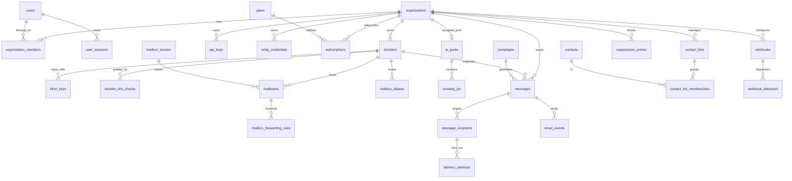

# Database Schema & Entity-Relationship Design (PostgreSQL)

**Status:** Draft — Awaiting Stakeholder Approval  
**Database:** PostgreSQL 16+  
**Primary Key Strategy:** `UUIDv7` (time-ordered UUIDs for B-tree index locality across high-write tables).  
**Migration Authority:** Single SQL migration ledger shared by Node.js (Prisma) and Rust (SQLx).

---

## 1. Entity-Relationship Overview

---

## 2. Core Schema Design by Domain

### A. Identity, Tenancy & RBAC
- **`users`**: `id (UUID PK)`, `email (CITEXT UNIQUE)`, `password_hash (TEXT, Argon2id)`, `full_name`, `email_verified_at`, `mfa_enabled (BOOL)`, `status (active|suspended|deleted)`, `platform_role (none|platform_operator|super_admin)`, `created_at`, `updated_at`, `deleted_at`.
- **`user_sessions`**: `id`, `user_id (FK)`, `app_surface (web|mail|admin)`, `refresh_token_hash`, `token_family_id`, `ip_address`, `user_agent`, `mfa_verified_at`, `expires_at`, `revoked_at`. *(Supports refresh-token rotation & family revocation on token reuse.)*
- **`mfa_credentials`**: `id`, `user_id (FK)`, `type (totp|webauthn)`, `encrypted_secret`, `backup_codes_hash`, `last_used_at`.
- **`organizations`**: `id`, `name`, `slug (UNIQUE)`, `status (active|suspended|pending_review)`, `sending_mode (sandbox|live)`, `default_ip_pool_id (FK)`, `daily_send_limit`, `monthly_send_limit`, `created_at`.
- **`organization_members`**: `id`, `organization_id (FK)`, `user_id (FK)`, `role (owner|admin|developer|read_only_analyst)`, `UNIQUE(organization_id, user_id)`.
- **`audit_logs`** *(Partitioned monthly by `created_at`)*: `id`, `actor_user_id`, `actor_ip`, `organization_id`, `action`, `resource_type`, `resource_id`, `before_state (JSONB)`, `after_state (JSONB)`, `created_at`.

### B. Domains, DNS & Deliverability
- **`domains`**: `id`, `organization_id (FK)`, `domain_name (CITEXT UNIQUE)`, `verification_token`, `ownership_verified_at`, `sending_enabled (BOOL)`, `hosting_enabled (BOOL)`, `is_suspended (BOOL)`, `suspension_reason`, `active_dkim_selector`, `custom_return_path_domain`, `custom_tracking_domain`, `dmarc_policy (none|quarantine|reject)`, `created_at`.
- **`dkim_keys`**: `id`, `domain_id (FK)`, `selector`, `algorithm (rsa2048|ed25519)`, `public_key_dns_txt`, `encrypted_private_key (BYTEA)`, `key_encryption_version (INT)`, `status (active|retiring|revoked)`, `rotated_at`, `created_at`, `UNIQUE(domain_id, selector)`.
- **`domain_dns_checks`**: `id`, `domain_id (FK)`, `spf_status`, `dkim_status`, `dmarc_status`, `mx_status`, `ptr_status`, `details (JSONB with remediation instructions)`, `checked_at`.

### C. Sending IPs, Pools & Reputation
- **`ip_pools`**: `id`, `name`, `type (shared_transactional|shared_bulk|dedicated|warmup)`, `is_suspended (BOOL)`, `created_at`.
- **`sending_ips`**: `id`, `ip_pool_id (FK)`, `ipv4_address (INET UNIQUE)`, `ipv6_address (INET)`, `ptr_hostname`, `warmup_stage (INT)`, `daily_quota (INT)`, `sent_today (INT)`, `reputation_score (NUMERIC)`, `status (active|warming|paused|retired)`.
- **`provider_rate_limits`**: `id`, `ip_pool_id (FK nullable)`, `remote_domain_pattern (e.g. gmail.com)`, `max_connections`, `max_msgs_per_minute`, `backoff_multiplier`.
- **`mta_nodes`**: `id`, `hostname (UNIQUE)`, `roles (TEXT[])`, `status (healthy|draining|maintenance|offline)`, `active_connections`, `queue_lag_ms`, `last_heartbeat_at`.

### D. API Keys & SMTP Credentials
- **`api_keys`**: `id`, `organization_id (FK)`, `name`, `key_prefix (VARCHAR(12))`, `key_hash (TEXT, SHA-256 of high-entropy token)`, `scopes (TEXT[])`, `rate_limit_rpm`, `last_used_at`, `expires_at`, `revoked_at`.
- **`smtp_credentials`**: `id`, `organization_id (FK)`, `domain_id (FK nullable)`, `username (UNIQUE)`, `password_hash (TEXT, Argon2id)`, `allowed_sender_patterns (TEXT[])`, `max_rate_per_min`, `last_used_at`, `failed_auth_count`, `revoked_at`.

### E. Mailbox Hosting (Dovecot Integration)
- **`mailbox_servers`**: `id`, `name`, `lmtp_host`, `lmtp_port`, `imap_host`, `imap_port`, `storage_path`, `status (active|draining|full)`.
- **`mailboxes`**: `id`, `organization_id (FK)`, `domain_id (FK)`, `server_id (FK)`, `local_part`, `email_address (CITEXT UNIQUE)`, `password_hash (TEXT, Argon2id with {ARGON2ID} prefix or formatted view for Dovecot)`, `display_name`, `quota_bytes (BIGINT)`, `used_bytes (BIGINT)`, `status (active|suspended)`, `is_catch_all (BOOL)`, `created_at`.
- **`mailbox_aliases`**: `id`, `domain_id (FK)`, `source_address (CITEXT UNIQUE)`, `destination_addresses (TEXT[])`, `is_active (BOOL)`.
- **`mailbox_forwarding_rules`**: `id`, `mailbox_id (FK)`, `forward_to_address`, `keep_local_copy (BOOL)`, `is_active (BOOL)`.
- **`webmail_contacts`**, **`webmail_signatures`**, **`webmail_scheduled_messages`**: Scoped strictly by `mailbox_id (FK)`.

### F. Core Messaging, Delivery Attempts & Analytics (High-Volume Tables)
- **`messages`**:
  - `id (UUIDv7 PK)`, `organization_id (FK)`, `domain_id (FK)`, `campaign_id (FK nullable)`, `source_type (api|smtp|campaign|webmail)`, `direction (outbound|inbound)`
  - `idempotency_key (VARCHAR(128))` — `UNIQUE(organization_id, idempotency_key) WHERE idempotency_key IS NOT NULL`
  - `envelope_from`, `header_from`, `subject`, `message_id_header`, `body_storage_key (TEXT)`, `size_bytes (INT)`
  - `state (created|queued|processing|accepted_remote|deferred|bounced|rejected|cancelled)`
  - `ip_pool_id (FK)`, `scheduled_at`, `created_at`, `updated_at`
- **`message_recipients`**:
  - `id (UUIDv7 PK)`, `message_id (FK)`, `organization_id`, `recipient_email (CITEXT)`, `recipient_domain (TEXT)`, `recipient_type (to|cc|bcc)`
  - `state (queued|processing|accepted_remote|deferred|bounced|rejected|cancelled)`
  - `attempt_count (SMALLINT)`, `next_retry_at (TIMESTAMPTZ)`, `ambiguous_after_data (BOOL DEFAULT FALSE)`
  - `last_smtp_code (SMALLINT)`, `last_enhanced_code (VARCHAR(16))`, `last_smtp_response (TEXT)`, `remote_mx_host (TEXT)`, `completed_at`, `created_at`
  - **Index:** Partial index `ON message_recipients (next_retry_at) WHERE state = 'deferred'` for fast retry polling.
- **`delivery_attempts`** *(Partitioned monthly by `attempted_at`)*:
  - `id (UUIDv7)`, `message_recipient_id`, `message_id`, `organization_id`, `mta_node_id`, `sending_ip (INET)`, `remote_mx_host`, `remote_ip (INET)`, `tls_used (BOOL)`, `tls_verified (BOOL)`, `tls_cipher`, `attempt_no`, `smtp_code`, `enhanced_code`, `smtp_response`, `outcome (accepted|deferred|bounced|rejected|network_error)`, `duration_ms`, `attempted_at`, `PRIMARY KEY (id, attempted_at)`
- **`email_events`** *(Partitioned monthly by `occurred_at`)*:
  - `id (UUIDv7)`, `organization_id`, `domain_id`, `campaign_id`, `message_id`, `message_recipient_id`, `event_type (accepted|delivered|deferred|bounced|rejected|complained|unsubscribed|opened|clicked)`, `metadata (JSONB)`, `occurred_at`, `PRIMARY KEY (id, occurred_at)`
- **`daily_domain_metrics`** *(Pre-aggregated rollup table)*:
  - `organization_id`, `domain_id`, `metric_date`, `sent`, `accepted_remote`, `deferred`, `hard_bounced`, `soft_bounced`, `complaints`, `opens`, `clicks`, `unsubscribes` — ensures sub-50ms dashboard queries across 30/90-day windows.

### G. Campaigns, Templates, Suppressions & Webhooks
- **`templates`** & **`template_versions`**: Versioned HTML/plain-text bodies, variable schema, categories.
- **`contact_lists`**, **`contacts`**, **`contact_list_memberships`**: Tagging, consent timestamp/source (`consent_source`, `consented_at`), segmentation metadata.
- **`suppression_entries`**: `id`, `organization_id (FK nullable for global platform blocks)`, `email (CITEXT)`, `reason (hard_bounce|complaint|unsubscribe|manual)`, `source_message_id`, `created_at`, `UNIQUE(organization_id, email)`.
- **`campaigns`**: `id`, `organization_id (FK)`, `domain_id (FK)`, `template_version_id (FK)`, `name`, `status (draft|scheduled|running|paused|completed|cancelled)`, `scheduled_at`, `timezone`, `target_filter (JSONB)`, `stats_cache (JSONB)`.
- **`webhooks`** & **`webhook_deliveries`**: Encrypted signing secret, secret-rotation grace window, event subscriptions, retry schedule, response status capture.
- **`outbox_events`**: `id (BIGSERIAL PK)`, `aggregate_type`, `aggregate_id`, `exchange`, `routing_key`, `payload (JSONB)`, `status (pending|published|failed)`, `created_at`, `published_at`.

### H. Billing & System Configuration
- **`plans`**, **`subscriptions`**, **`usage_records`** (per billing cycle counters), **`invoices`**.
- **`system_settings`**: `id`, `version (INT UNIQUE)`, `config (JSONB — max message size, attachment size, connection limits, retry policy, abuse thresholds, maintenance mode)`, `updated_by (FK users)`, `created_at`.

---

## 3. Partitioning, Retention & Storage Strategy

| Table / Asset | Growth at 20M msg/mo | Strategy |
|---|---|---|
| `email_events`, `delivery_attempts`, `audit_logs` | 60M–100M rows/mo | Declarative PostgreSQL monthly range partitions; auto-create +2 months ahead; archive/drop raw partitions after configurable retention (e.g. 90–180 days) while preserving `daily_domain_metrics` rollups indefinitely. |
| `messages` / `message_recipients` | 20M+ rows/mo | `UUIDv7` PKs; quarterly/monthly partitioning once >100M rows; vacuum tuning (`autovacuum_vacuum_scale_factor = 0.02`). |
| MIME Bodies & Attachments | 1–3 TB/mo if ~50–150KB avg | **Never stored in PostgreSQL.** Stored on NVMe Spool / S3-compatible object store via `body_storage_key` with SHA-256 integrity hash and configurable TTL cleanup after delivery completion. |
