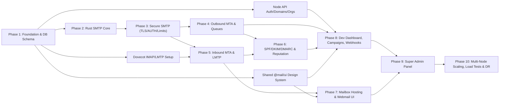

# Phased Implementation Roadmap & Dependency Plan

**Status:** Draft — Awaiting Stakeholder Approval

---

## 1. Dependency Graph & Parallelization Strategy

### Critical Path (Must Be Built Sequentially First)
1. **Phase 1 (Foundation)**: Monorepo, SQL migrations, Core Schema, Docker Compose (Postgres, Redis, RabbitMQ), shared Zod/TS contracts, Rust Cargo workspace -> **Blocks everything**.
2. **Phase 2 (SMTP Core)** -> **Phase 3 (Secure SMTP)** -> **Phase 4 (Outbound MTA)** & **Phase 5 (Inbound MTA)**: The Rust SMTP protocol engine (`smtp-protocol`) must stabilize before TLS/AUTH, which must stabilize before production outbound/inbound workers.

### Independent / Parallel Workstreams (Once Phase 1 Contracts Are Frozen)
- **Track A (Rust MTA Core)**: Phases 2 -> 3 -> 4 -> 5 -> 6.
- **Track B (Node.js Control Plane & Outbox/Campaigns/Webhooks)**: Can begin immediately after Phase 1 DB schema + API contracts freeze, building Auth, RBAC, Org/Domain CRUD, API Keys, SMTP Credentials, Transactional API -> Outbox, Templates, Campaigns, Webhooks, and Billing in parallel with Rust SMTP protocol work.
- **Track C (Dovecot & Mailbox Hosting)**: Dovecot container + PostgreSQL `passdb`/`userdb` + LMTP/IMAP setup can be built and tested in parallel with Phases 2–4, ready to integrate with Rust `inbound-processor` in Phase 5 and `mailbox-service` + `apps/mail` in Phase 7.
- **Track D (Frontend Design System & SPAs)**: `@mail/ui` (Tailwind v4 + Base UI + shadcn/ui) and `apps/web`, `apps/mail`, `apps/admin` shells can proceed in parallel against frozen OpenAPI/Zod schemas once Phase 1 completes.

---

## 2. Phased Roadmap with Measurable Acceptance Criteria

### Phase 1: Foundation & Contracts
- **Scope**: Monorepo (`apps/`, `services/`, `crates/`, `packages/`, `migrations/`, `infrastructure/`), Docker Compose dev stack (PostgreSQL 16, Redis, RabbitMQ, Prometheus/Grafana), SQL-first migrations for core tables, Express API skeleton, Rust workspace with `observability` crate (`tracing` JSON + Prometheus metrics), CI pipeline (`cargo clippy`, `tsc --noEmit`, lint).
- **Acceptance Criteria**:
  - `docker compose up` boots Postgres, Redis, RabbitMQ cleanly with healthchecks passing.
  - All core SQL migrations apply cleanly on empty DB; Prisma and Rust `sqlx` both compile and pass smoke queries against the same DB.
  - CI pipeline fails on any TypeScript strict error, Rust clippy warning, or migration mismatch.

### Phase 2: Custom Rust SMTP Core (`smtp-protocol`, `smtp-server`, `smtp-session`)
- **Scope**: Sans-I/O RFC 5321 state machine (`EHLO`, `HELO`, `MAIL FROM`, `RCPT TO`, `DATA`, `RSET`, `NOOP`, `QUIT`, `SIZE`, `8BITMIME`, `SMTPUTF8`, `PIPELINING`), CRLF framing, fragmented/coalesced TCP buffer handling, dot-unstuffing, multiline responses, connection timeouts.
- **Acceptance Criteria**:
  - Unit & fuzz/property tests verify parser handles arbitrary TCP chunk boundaries (1-byte splits and pipelined bursts) with zero panics or state corruption.
  - Automated protocol test suite passes full SMTP dialogues, invalid state transitions (`503`), oversized messages (`552`), and dot-stuffing round-trips.
  - Benchmark baseline recorded for parser throughput & concurrent idle/active sessions.

### Phase 3: Secure SMTP (TLS, AUTH, Limits, Anti-Relay)
- **Scope**: `STARTTLS` (587/25) and implicit TLS (465) via `rustls`, `AUTH PLAIN`/`LOGIN` (strictly post-TLS, Argon2id verified), bounded connection semaphore, per-IP Redis rate limits, open-relay enforcement on Port 25.
- **Acceptance Criteria**:
  - Security test suite proves unauthenticated Port 25 **rejects (`550`/`554`)** any non-hosted external recipient (zero open relay).
  - Unencrypted Port 587 rejects `AUTH` (`538` / not advertised in `EHLO` until `STARTTLS` succeeds).
  - Oversized payloads, connection floods, and invalid sender domains are rejected cleanly without OOM or socket leaks.

### Phase 4: Outbound MTA & Durable Queue Pipeline
- **Scope**: `dns-resolver` (`hickory-dns` with TTL cache + Null MX), `smtp-outbound` RabbitMQ consumer (`lapin` with publisher confirms & DLQ), `delivery-engine` (connection pooling, per-domain rate limits, opportunistic/strict STARTTLS, exponential backoff + jitter, ambiguous post-DATA handling, `delivery_attempts` persistence), Outbox Relay in `services/scheduler`, internal REST `/v1/emails` send endpoint.
- **Acceptance Criteria**:
  - End-to-end test: HTTP `POST /v1/emails` -> DB outbox -> RabbitMQ -> Rust `smtp-outbound` -> sink SMTP server delivers message with `delivery_attempts` and `message_recipients.state = 'accepted_remote'`.
  - Chaos test: Killing `smtp-outbound` mid-flight leaves zero lost messages; RabbitMQ redelivers and DB idempotency/state prevents silent disappearance.
  - Simulated remote `421` triggers exponential retry; `550` transitions immediately to `bounced` without retry.

### Phase 5: Inbound MTA & Dovecot LMTP Integration
- **Scope**: Dovecot container (LMTP + IMAP + Maildir + Postgres Argon2id auth), Rust `inbound-processor`, synchronous `RCPT TO` domain/mailbox/alias/catch-all validation, `mailbox-client` LMTP delivery, VERP bounce & DSN/ARF parser (`bounce-handler`), basic spam/policy pipeline.
- **Acceptance Criteria**:
  - External SMTP `DATA` to hosted mailbox delivers via Dovecot LMTP and appears in IMAP `INBOX` within <2s locally; unknown recipients rejected at `RCPT TO` with `550 5.1.1`.
  - Sending a simulated RFC 3464 hard bounce to VERP address updates original `message_recipients` to `bounced` and inserts `suppression_entries`.
  - Zero direct Maildir file writes from Rust or Node processes.

### Phase 6: Authentication, Deliverability & Reputation Engine
- **Scope**: Domain verification & DNS check engine (SPF, DKIM, DMARC, MX, PTR with actionable remediation), `dkim` envelope-encrypted key generation/rotation/signing (RSA-2048 + Ed25519), inbound `mail-auth` SPF/DKIM/DMARC verification + `Authentication-Results`, IP pools & warmup stage quotas, abuse circuit breakers.
- **Acceptance Criteria**:
  - Outbound messages carry valid DKIM signatures verified independently by `mail-auth` and third-party verifier suites.
  - Decrypted DKIM private keys are inaccessible via any API endpoint or log output.
  - Exceeding configured bounce/complaint thresholds automatically suspends test tenant sending and logs an audit entry.

### Phase 7: Mailbox Hosting & Webmail UI (`apps/mail` + `services/mailbox-service`)
- **Scope**: Domain/mailbox/alias/forwarding/quota management APIs, `mailbox-service` IMAP pool + `IDLE`/`CONDSTORE` sync + attachment streaming, React Webmail SPA (`apps/mail`: Inbox/Sent/Drafts/Starred/Archive/Spam/Trash/Folders/Labels, rich composer with autosave/drag-drop/inline images/scheduled send, threaded view, fast search, DOMPurify HTML isolation).
- **Acceptance Criteria**:
  - Multi-mailbox isolation verified: User A cannot read, search, or download attachments belonging to User B or another org.
  - Webmail XSS test suite verifies `<script>`, `onerror=`, and unsafe CSS payloads in inbound emails do not execute.
  - Real-time unread count and new-message refresh work via IMAP `IDLE` / push notifications.

### Phase 8: Email Infrastructure Dashboard, Campaigns, Templates & Webhooks (`apps/web`)
- **Scope**: Full Developer Dashboard (`apps/web`), SMTP credentials & API key management (reveal-once secrets), transactional templates + versioned editor, CSV contact import & consent-gated campaigns with timezone scheduling, open/click/RFC 8058 one-click unsubscribe endpoints, signed webhook dispatcher + retry history, DB-backed analytics dashboard + CSV export, multi-tier billing/usage tracking.
- **Acceptance Criteria**:
  - Zero hardcoded dashboard metrics; all charts reflect real partitioned `email_events` / `daily_domain_metrics` data with working date filters.
  - API keys and SMTP secrets are displayed only once at creation/rotation and verified never to appear in logs.
  - Webhook signatures validate with HMAC-SHA256; failed webhooks retry with backoff and appear in failure inspection UI.

### Phase 9: Platform Super Admin Panel (`apps/admin`)
- **Scope**: Isolated `apps/admin` SPA + MFA-enforced `/admin/v1/*` endpoints: overview & service health (Postgres/Redis/RabbitMQ/MTA nodes), user/org/domain management & suspension, MTA node maintenance/draining, RabbitMQ queue/DLQ inspection & audited retry/cancel, IP pool & reputation controls, RBAC & security session revocation, versioned `system_settings`.
- **Acceptance Criteria**:
  - Non-super-admin or non-MFA sessions are rejected (`403`) on all admin routes.
  - Draining an MTA node stops new inbound/outbound claims while gracefully completing in-flight SMTP transactions.
  - Every admin mutation writes an immutable `audit_logs` entry with before/after state.

### Phase 10: Production Scaling, Load Testing & Disaster Recovery
- **Scope**: Multi-node Rust `mail-engine` deployment, `message-storage` migration to S3/MinIO object storage, Dovecot sharding readiness (`server_id` routing), automated load tests (SMTP parser, concurrent sessions, queue ingestion, outbound throughput, memory/CPU profiles), Prometheus/Grafana alerting rules, OpenTelemetry distributed traces across API -> RabbitMQ -> Rust MTA -> Dovecot, backup/restore drills.
- **Acceptance Criteria**:
  - Automated load test suite demonstrates sustained target throughput (equivalent to >=20M emails/month with burst headroom) on benchmark infrastructure with documented CPU/RAM/latency telemetry (clearly separated from external ISP deliverability).
  - Point-in-time PostgreSQL restore and RabbitMQ node restart recovery tests pass with zero committed message loss.
